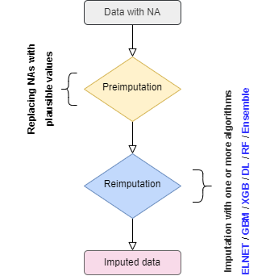
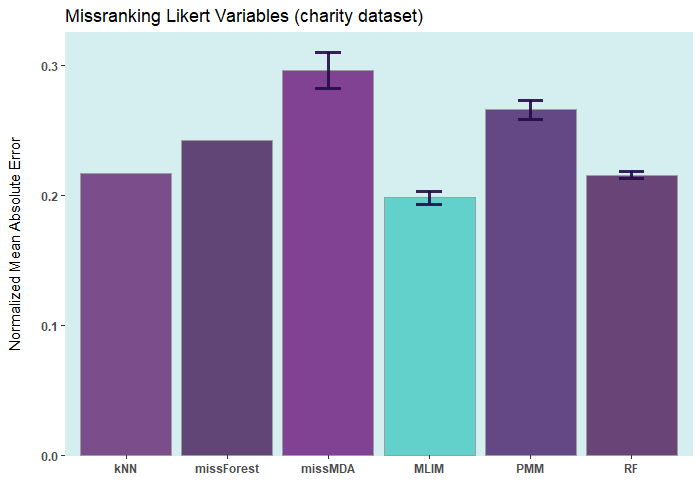
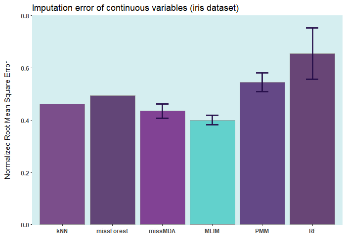
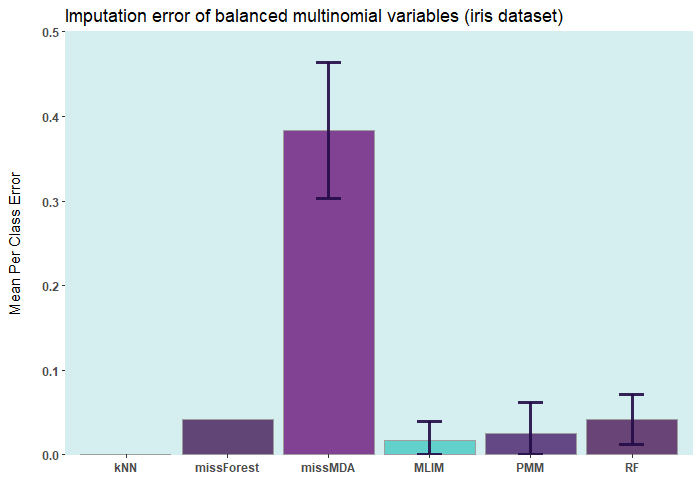
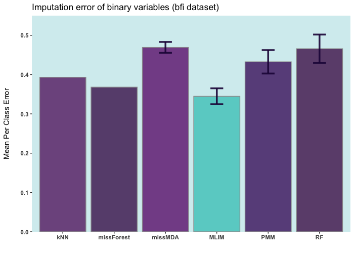
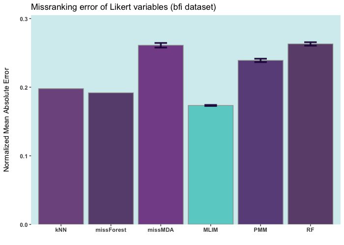
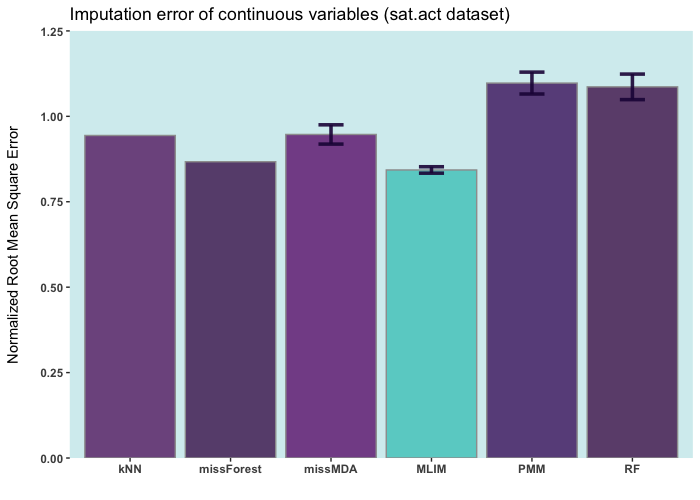
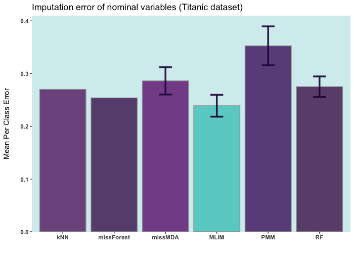

<a href="https://github.com/haghish/mlim"></a>

**`mlim`** : Single and Multiple Imputation for `R` and `Stata` with Automated Machine Learning
================================================================

[](https://github.com/haghish/mlim/releases/?include_prereleases&sort=semver "View GitHub releases")
[](https://cran.r-project.org/package=mlim)  [](https://cran.r-project.org/package=mlim) [](https://CRAN.R-project.org/package=mlim)
<!--  [](https://github.com/haghish/mlim_handbook/blob/main/mlim_handbook.pdf) 

[](https://cran.r-project.org/package=mlim) https://shields.io/ 

[](https://github.com/haghish/mlim/releases/?include_prereleases&sort=semver "View GitHub releases")
 -->

**`mlim`** is an open-source statistical software for single and multiple imputation of missing data using automated machine learning. It is freely available in __R__ and __Stata__. The aim is to make model-based imputation accessible for datasets containing mixed data types easier (e.g., continuous, binary, ordinal, and nominal variables), while allowing the models to be __fine-tuned__ separately for the variables that require imputation. To the author's knowledge, **`mlim`** is the first statistical software to allow machine-learning imputation with automated fine-tuning, which is expected to not only enhance imputation accuracy, but also, reduce bias. **Importantly, `mlim` is also suitable for imputing longitudinal and hierarchical data**, providing a simple and robust solution for missing data imputation of several data types simultaneously. 

In a nutshel, instead of applying one fixed prediction model to every variable, **`mlim`** searches for suitable hyperparameters using cross-validation. Users can select elastic net, random forests, gradient boosting, and other machine-learning algorithms for imputation and specify the amount of computational resources they wish to provide for fine-tuning each of the variables.

## Why use `mlim`?

Missing data imputation is challenging when variables have different measurement levels, nonlinear relationships, interactions, or highly unequal category frequencies. **`mlim`** was developed to address some of these challenge. The main features of this package are:

- **Automated fine-tuning.** Models are tuned separately for imputed variables, using cross-validation to compare candidate settings.
- **Mixed data types.** Continuous, binary, nominal, and ordinal variables can be included in the same dataset. Ordinal variables are, by default, treated as ordered numeric responses during model fitting and then converted back to their original categories.
- **Different machine-learning algorithms**: Users can select one learner, compare several learners, or request a stacked ensemble of multiple learners.
- **Single and multiple imputation**: Multiple imputation uses bootstrap-based model fitting and stochastic draws to generate different completed datasets.
- **Imbalanced categorical variables**: Automatic class balancing is available for categorical outcomes in the standard learners. This may improve representation of uncommon categories, although it does not guarantee unbiased estimates.
- **Hierarchical data**: Hierarchy identifiers and the level at which variables are measured can be specified. The **`HML`** learner models nested random intercepts.
- **R** and **Stata**: The imputation models run in R; Stata users can invoke them without manually exporting and importing each completed dataset.

Fine-tuning missing data imputation
-----------------------------------

Simply put, for each variable in the dataset, **`mlim`** automatically fine-tunes a fast machine learning model, which results in significantly lower imputation error compared to classical statistical models or even untuned machine learning imputation software that use Random Forest or unsuperwised learning algorithms. Moreover, **`mlim`** is intended to give social scientists a powerful solution to their missing data problem, a tool that can automatically adopts to different variable types, that can appear at different rates, with unknown destributions and have high correlations or interactions with one another. **But it is not just about higher accuracy! `mlim` also delivers fairer imputation, particularly for categorical and ordinal variables because it automatically balances the levels of the avriable, minimizing the bias resulting from class imbalance, which can often be seen in social science data and has been commonly ignored by missing data imputation software.**

**`mlim`** outperforms other R packages for all variable types, continuous, binary (factor), multinomial (factor), and ordinal (ordered factor). The reason for this improved performance is that **`mlim`**:

- Automatically fine-tunes the parameters of the Machile Learning models
- Delivers a very high prediction accuracy
- Does not make any assumption about the destribution of the data 
- Takes the interactions between the variables into account 
- Can to some extend take the hierarchical structure of the data into account 
  + Imputes missing data in nested observations with higher accuracy compared to the HLM imputation methods
- Does not force a particular linear model 
- Uses a blend of different machine learning models 

<!-- 

Download mlim multiple imputation handbook
------------------------------------------

<a href="https://github.com/haghish/mlim_handbook/blob/main/mlim_handbook.pdf"></a> `mlim` comes with a free and open-source handbook to help you get started with either single or multiple imputation. The handbook is written in _LaTeX_ and its source is publically hosted on GitHub, visit [github.com/haghish/mlim_handbook](https://github.com/haghish/mlim_handbook) for more information. 

<br>
<br>
<br>
<br>
-->

How the imputation procedure works
---------------------------------------------------------

The procedure consists of several steps:

1. **Identify missing variables.** `mlim` selects variables containing some observed and some missing values. Completely missing variables cannot be estimated from their own observed information. Variables can be excluded from imputation using `ignore`.
2. **Preimputation.** Missing predictors are temporarily initialized using random sampling (`preimpute = "random"`, the default) or the median/mode (`preimpute = "mm"`). An experimental random-forest initialization (`"rf"`) is also available. These initial values are not the final imputations.
3. **Model tuning.** For each target variable, the chosen learner or learners are fitted using the observed values of that target. Candidate models are evaluated by cross-validation. The number of evaluations and the available tuning time can be limited.
4. **Iterative updates.** The model predicts the missing values, and the imputed dataset is updated. The procedure can continue through several iterations, subject to the stopping criterion and `maxiter`.
5. **Stochastic imputation.** For multiple imputation, stochastic variation is enabled by default. The standard numeric learners use residual variation based on cross-validation RMSE. However, categorical variables are sampled using predicted class probabilities. For longitudinal and hierarchical imputation, the `HML` procedure uses hierarchical predictive distributions.

 

Fast imputation with **`ELNET`**
---------------------------------------------------------

Below are some comparisons between different R packages for carrying out multiple imputations (bars with error) and single imputation. In these analyses, I only used the **`ELNET`** algorithm, which fine-tunes much faster than other algorithms (**`GBM`**, **`XGB`**, and **`DL`**). As it evident, **`ELNET`** already outperforms all other single and multiple imputation procedures available in **R** language. 



## Installation

### R

Install directly from GitHub:

```r
install.packages("remotes")
remotes::install_github("haghish/mlim")

# Required packages
install.packages(c("partykit", "sandwich", "coin", "gbm", "lightgbm", "kernlab", "kknn", "readstata13", "remotes"))

# Optional packages fot catBoost imputation (for Mac)
remotes::install_url("https://github.com/catboost/catboost/releases/download/v1.2.10/catboost-R-darwin-universal2-1.2.10.tgz",
  INSTALL_opts = c("--no-multiarch", "--no-test-load", "--no-staged-install"))

# Optional packages fot catBoost imputation (for Windows)
remotes::install_url(
  "https://github.com/catboost/catboost/releases/download/v1.2.10/catboost-R-windows-x86_64-1.2.10.tgz", 
  INSTALL_opts = c("--no-multiarch", "--no-test-load"))

# Optional package for catboost imputation (for Linux X86_64)
remotes::install_url("https://github.com/catboost/catboost/releases/download/v1.2.10/catboost-R-Linux-1.2.10.tgz",
                     INSTALL_opts = c("--no-multiarch", "--no-test-load", "--no-staged-install"))

# Optional package for catboost imputation (for Linux Aarch64)
remotes::install_url("https://github.com/catboost/catboost/releases/download/v1.2.10/catboost-R-linux-aarch64-1.2.10.tgz",
                     INSTALL_opts = c("--no-multiarch", "--no-test-load", "--no-staged-install"))

# Additional learners (RECOMMENDED!)
install.packages("mlr3extralearners", repos = c(mlrorg = "https://mlr-org.r-universe.dev"))
```

The package uses `mlr3`, `mlr3tuning`, `mlr3pipelines`, and related packages for model training and tuning. Selected algorithms may require additional packages. For example:

```r
install.packages(c("mlr3learners", "glmnet", "ranger", "gbm", "xgboost"))

# Additional learners, when needed
install.packages("mlr3extralearners",
                 repos = c(mlrorg = "https://mlr-org.r-universe.dev"))

# For experimental hierarchical imputation
install.packages("gpboost")  # check platform-specific availability
```

Other optional backends include `partykit`, `sandwich`, `coin`, `lightgbm`, `catboost`, `nnet`, `kernlab`, and `kknn`. Install the backend corresponding to the algorithm you want to use. Not all of these packages are available on every operating system through the same installation method. 

### Stata

The Stata command calls the R package through [`rcall`](https://github.com/haghish/rcall). Install and configure `rcall` first, ensure that R is available to Stata, and install the R development package as shown above. Then install the Stata command from its GitHub repository using the [`github`](https://github.com/haghish/github) Stata package:

```stata
github install haghish/mlim
```

Supported algorithms
--------------------

The following algorithm names are recognized by **`mlim`**:

| Algorithm | Description      | Notes |
|-----------|------------------|-------|
| `ELNET`   | Elastic net regression | Default; a practical starting point with relatively low computational requirements |
| `RF`      | Random forest | Captures nonlinear patterns and interactions |
| `CRF`     | Conditional random forest | Requires additional tree-related packages |
| `GBM`     | Gradient boosting | Requires the corresponding backend; some target types may be unsupported |
| `XGB`     | XGBoost | Boosted decision trees |
| `CAT`     | CatBoost | Optional backend and platform-dependent installation |
| `NNET`    | Neural network | Optional learner backend |
| `HML` | Hierarchical machine learning (GPBoost) | Experimental; requires `hierarchy` and must currently be used alone |
<!--
| `SVM` | Support vector machine | Optional learner backend |
| `KNN` | k-nearest neighbors | Not used for bootstrap-weighted multiple imputation in the current implementation |
| `NB` | Naive Bayes | Supported by the syntax validator; check target-specific learner availability |
| `ENSEMBLE` | Stacked ensemble | Requires at least two additional base algorithms |
-->

`LGBM` appears in parts of the learner documentation and Stata help, but is not accepted by the current R syntax validator. Until those files are made consistent, it should **not** be presented as a generally available algorithm in `dev`.

`ELNET` is the default because it is relatively fast to tune, not because it always produces the lowest error. More complex models can improve prediction in some datasets but may require substantially more computing time.


### `GBM` vs `ELNET`

But which one should you choose, assuming computation resources are not in question? Well, __`GBM`__ is very liokely to outperform __`ELNET`__, if you specify a large enough `max_models` argument to well-tune the algorithm for imputing each feature. That basically means generating more than 100 models, at least. But you will enjoy a slight -- yet probably statistically significant -- improvement in the imputation accuracy. The option is there, for those who can use it, and to my knowledge, fine-tuning __`GBM`__ with large enough number of models will be the most accurate imputation algorithm compared to any other procedure I know. But __`ELNET`__ comes second and compared to its speed advantage, it is indeed charming!

Both of these algorithms offer one advantage over all the other machine learning missing data imputation methods such as kNN, K-Means, PCA, Random Forest, etc... Simply put, you do not need to specify any parameter yourself, everything is automatic and **`mlim`** searches for the optimal parameters for imputing each variable within each iteration. For all the aformentioned packages, some parameters need to be specified, which influence the imputation accuracy. Number of _k_ for kNN, number of components for PCA, number of trees (and other parameters) for Random Forest, etc... This is why `elnet` outperform the other packages. You get a software that optimizes its models on its own. 

Advantages and limitations
--------------------------

**`mlim`** fine-tunes models for imputation, a procedure that has never been implemented in other R packages. This procedure often yields much higher accuracy compared to other machine learning imputation methods or missing data imputation procedures because of using more accurate models that are fine-tuned for each feature in the dataset. The cost, however, is computational resources. If you have access to a very powerful machine, with a huge amount of RAM per CPU, then try __`GBM`__. If you specify a high enough number of models in each fine-tuning process, you are likely to get a more accurate imputation that __`ELNET`__. However, for personal machines and laptops, __`ELNET`__ is generally recommended (see below). __If your machine is not powerful enough, it is likely that the imputation crashes due to memory problems...__. So, perhaps begin with __`ELNET`__, unless you are working with a powerful server. This is my general advice as long as **`mlim`** is in Beta version and under development.


Citation 
--------

- Haghish, E. F. (2022). mlim: Multiple Imputation with Automated Machine Learning [Computer software]. https://CRAN.R-project.org/package=mlim. 
<!-- - Haghish, E. F. (2022). mlim Multiple Imputation Handbook. Software Manual. https://github.com/haghish/mlim_handbook. -->

<!--
Preimputation
-------------

**`mlim`** implements a trick to reduce number of iterations needed for reaching the optimized imputation. Usually, prior to the imputation, the missing data are replaced with mean, mode, or even random values from within the variable. This is a fair start-point for the imputation procedure, but makes the optimization very time consuming. Another possibility would be to use a fast and well-established imputation algorithm for the pre-imputation and then improve the imputed values. **`mlim`** supports the following algorithms for preimputation:

| **Algorithm**  |    **Speed**   |  **RAM** |  **CPU**  |
|:---------------|:---------------|:---------|:----------|
| `knn`       |    Very fast   |    Low   |    Low    |
| `rf`    |      fast      |   High   |    High   |
| `mm`        | Extremely fast | Very Low |  Very Low |

-->

Example 
-------

`iris` ia a small dataset with 150 rows only. Let's add 50% of artifitial missing data and compare several state-of-the-art machine learning missing data imputation procedures. __`ELNET`__ comes up as a winner for a very simple reason! Because it was fine-tuned and all the rest were not. The larger the dataset and the higher the number of features, the difference between __`ELNET`__ and the others becomes more vivid. 

### Single imputation

In a single imputation, the NAs are replaced with the most plausible values according the model. You do not get the diversity of the multiple imputation, but you still get an estimated imputation error based on 10-fold (or higher, if specified) cross-validation procedure for each variable (column) in the dataset. As shown below, `mlim` provides the **`mlim.error()`** function to summarize the imputation error for the entire dataset or each variable. 

```R
# Comparison of different R packages imputing iris dataset
# ===============================================================================
rm(list = ls())
library(mlim)
library(mice)
library(missForest)
library(VIM)

# Add artifitial missing data
# ===============================================================================
irisNA <- mlim.na(iris, p = 0.5, stratify = TRUE, seed = 2022)

# Single imputation with mlim, giving it 180 seconds to fine-tune each imputation
# ===============================================================================
MLIM <- mlim(irisNA, m=1, seed = 2022, tuning_time = 180) 
print(MLIMerror <- mlim.error(MLIM, irisNA, iris))

# kNN Imputation with VIM
# ===============================================================================
kNN <- kNN(irisNA, imp_var=FALSE)
print(kNNerror <- mlim.error(kNN, irisNA, iris))

# Single imputation with MICE (for the sake of demonstration)
# ===============================================================================
MC <- mice(irisNA, m=1, maxit = 50, method = 'pmm', seed = 500)
print(MCerror <- mlim.error(MC, irisNA, iris))

# Random Forest Imputation with missForest
# ===============================================================================
set.seed(2022)
RF <- missForest(irisNA)
print(RFerror <- mlim.error(RF$ximp, irisNA, iris))
```

### Multiple imputation

`mlim` supports multiple imputation. All you need to do is to specify an integer higher than 1 for the value of `m`. For example, set `m = 5` in the `mlim` function to impute 5 datasets. Then, `mlim` returns a list including 5 datasets. You can convert this list to a `mids` object using the **`mlim.mids()`** function and then follow up the analysis with the `mids` object the same way it is carried out by the [`mice`](https://CRAN.R-project.org/package=mice) R package. Here is an example:

```R
# Comparison of different R packages imputing iris dataset
# ===============================================================================
rm(list = ls())
library(mlim)
library(mice)

# Add artifitial missing data
# ===============================================================================
irisNA <- mlim.na(iris, p = 0.5, stratify = TRUE, seed = 2022)

# multiple imputation with mlim, giving it 180 seconds to fine-tune each imputation
# ===============================================================================
MLIM2 <- mlim(irisNA,  m = 5, seed = 2022, tuning_time = 180) 
print(MLIMerror2 <- mlim.error(MLIM2, irisNA, iris))
mids <- mlim.mids(MLIM2, dfNA)
fit <- with(data=mids, exp=glm(Species ~ Sepal.Length, family = "binomial"))
res <- mice::pool(fit)
summary(res)
```


